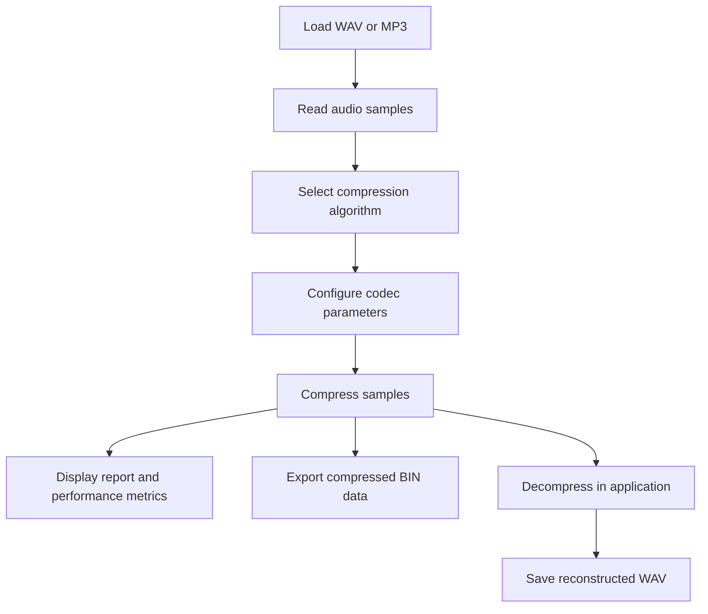

<div align="center">

# Desktop Audio Compressor

**An interactive Windows desktop application for exploring, applying, and comparing digital audio compression algorithms.**


</div>

## Overview

**Desktop Audio Compressor** is a C# Windows Forms project that demonstrates fundamental **digital audio compression and signal processing** techniques through a graphical interface. Users can load audio, select a codec, adjust compression parameters, examine performance indicators, and reconstruct audio from the compressed sample data.

The project focuses on the underlying **sample-level encoding and decoding algorithms**, rather than serving as a general-purpose MP3 or ZIP compressor. It provides an accessible environment for comparing how different approaches transform an audio signal.

## Features

- **Audio import:** Select or drag and drop `.wav` and `.mp3` files.
- **Audio playback:** Preview audio through the NAudio-based playback functionality.
- **Five selectable compression algorithms** with a common codec interface.
- **Configurable parameters:** μ-law parameter, step size, quantization levels, and a sample-rate control.
- **Compression and decompression:** Encode sample arrays and reconstruct audio from the encoded representation.
- **File export:** Save compressed data as `.bin` and decoded audio as `.wav`.
- **Performance monitoring:** View progress, processing time, size-related metrics, and charted performance data.
- **Cancellation and reset controls** for the desktop workflow.

## Compression Algorithms

The codecs are implemented in [`Compression/AudioCodecs.cs`](./Compression/AudioCodecs.cs).

| Algorithm | Core idea | Main consideration |
| --- | --- | --- |
| **Nonlinear Quantization (μ-law)** | Compands signal amplitudes before mapping each sample to an 8-bit value. | The μ parameter affects nonlinear amplitude representation. |
| **DPCM** | Encodes differences between consecutive quantized sample values. | Error representation and quantization influence reconstruction. |
| **Delta Modulation** | Encodes whether a sample is above or below the evolving estimate. | Step size influences tracking and reconstruction quality. |
| **Adaptive Delta Modulation** | Adjusts the tracking step based on successive comparisons. | Adaptation changes how the approximation follows the signal. |
| **Predictive Coding** | Uses prior signal information to represent the signal through prediction-related values. | Reconstruction depends on the predictor implementation. |

> **Implementation note:** These are educational codec implementations. They should not be assumed to be standardized, interoperable audio formats or lossless codecs. In particular, some encoder and decoder parameters are not handled identically across all implementations; reconstructed samples may therefore differ substantially from the original.

## Processing Workflow



### Architecture

The project separates its user interface from audio-file operations and compression algorithms:

- **Presentation:** `Form1.cs` manages loading, controls, audio preview, encoding, decoding, and file saving.
- **Monitoring:** `FormPerformance.cs` provides a separate performance window.
- **Audio I/O:** `Audio/AudioFileService.cs` handles audio-file-related operations.
- **Codec engine:** `Compression/AudioCodecs.cs` contains `IAudioCodec`, codec implementations, `CompressionSettings`, and `AudioCodecFactory`.

Each compression algorithm conforms to the `IAudioCodec` interface, which exposes `Compress(...)` and `Decompress(...)`. The factory selects an algorithm by its UI name, keeping codec selection separate from the main form's processing logic.

## Getting Started

### Prerequisites

- **Windows** (Windows Forms desktop application).
- **Visual Studio** with the **.NET desktop development** workload.
- **.NET Framework 4.7.2 targeting/developer pack**.
- Internet connection for the initial NuGet package restore.

The solution uses the classic **.NET Framework 4.7.2** project format, **not .NET 6/8/9**.

### Installation

1. Clone the repository:

   ```bash
   git clone https://github.com/MohammedAbdelkarem/Desktop_Audio_Compressor.git
   cd Desktop_Audio_Compressor
   ```

2. Open **`project1.sln`** in Visual Studio on Windows.
3. Restore NuGet packages (right-click the solution → **Restore NuGet Packages**, if needed).
4. Confirm that the **.NET Framework 4.7.2** targeting pack is installed.
5. Choose **Build → Build Solution**, then press **F5** to run.

If Visual Studio reports missing references, inspect `packages.config` and restore its dependencies before rebuilding.

### Principal Dependencies

The solution declares dependencies including:

| Package | Role |
| --- | --- |
| `NAudio` 2.3.0 | Audio reading, playback, and related audio APIs. |
| `OxyPlot.WindowsForms` 2.2.0 | Plotting support in the Windows Forms application. |
| `MathNet.Numerics` 5.0.0 | Numerical processing library reference. |
| `Emgu.CV` 4.13.0.5924 | Additional project dependency listed in NuGet configuration. |

See [`packages.config`](./packages.config) for the full dependency list.

## Usage

1. **Open an audio file** with the file picker or drag a supported file into the workspace.
2. **Select a compression algorithm** from the drop-down menu.
3. **Adjust relevant parameters** (such as μ, step size, or quantization levels).
4. **Compress** the loaded signal.
5. **Review performance** through the resulting report and the performance window.
6. **Save compressed data** as a `.bin` file, if desired.
7. **Decompress** the current in-memory encoded data and save the reconstruction as `.wav`.

> The provided UI decompresses its **current in-memory compressed data**. The observed code does not establish a standalone `.bin` import path or a self-describing container that stores all decoding parameters. Saving a `.bin` file should therefore not be interpreted as guaranteed independent reopening and decoding.

### Performance Metrics

The report displays the algorithm, selected settings, original sample-buffer size, compressed byte count, an indicated percentage saving, and elapsed processing time.

The size baseline is computed as **sample count × 4 bytes** (32-bit floating-point samples), not necessarily the original WAV/MP3 file size. Accordingly, its displayed percentage is a *sample-buffer comparison*, not a validated end-to-end reduction in source-file size. Some codecs may produce larger outputs under this calculation.

## Repository Structure

```text
Desktop_Audio_Compressor/
├── Audio/
│   └── AudioFileService.cs        # Audio file operations
├── Compression/
│   └── AudioCodecs.cs            # Codec interface, factory, algorithms
├── Properties/                  # Application resources and settings
├── Form1.cs                     # Main desktop workflow
├── Form1.Designer.cs            # Main form UI definitions
├── Form1.resx                   # Main form resources
├── FormPerformance.cs           # Performance-monitoring window
├── FormPerformance.Designer.cs  # Performance form UI definitions
├── FormPerformance.resx         # Performance form resources
├── Program.cs                   # Application entry point
├── App.config                   # Application configuration
├── packages.config              # NuGet package references
├── project1.csproj              # .NET Framework project
└── project1.sln                 # Visual Studio solution
```

## Learning Objectives

This project explores:

- Digital audio representation and amplitude quantization.
- Companding, differential coding, and predictive approaches.
- Lossy reconstruction and the influence of codec parameters.
- File-based audio processing and desktop application design.
- Extensible codec interfaces and factory-based instantiation.
- Compression-time and output-size measurement.

## Limitations and Potential Improvements

- **Metadata and portability:** Define a documented binary container storing the codec identifier, settings, sample rate, channel count, and sample count; add file-based decoding.
- **Codec reconstruction:** Align each encoder/decoder's initialization and parameter handling; add round-trip tests and audio-quality measurements.
- **Bit packing:** Some delta encoders store one logical decision per byte rather than packing decisions into individual bits.
- **Fair comparisons:** Report original file bytes separately from raw float-buffer bytes, plus signal-to-noise ratio, MSE, and perceptual audio comparisons.
- **Format consistency:** Preserve input sample-rate and channel metadata during WAV export instead of relying on fixed output values.
- **Automated testing:** Add unit tests for empty and short signals, clipping, parameter boundaries, cancellation, and codec round trips.
- **Packaging:** Provide a Windows release build, installer, and application screenshots.

## Contributing

Contributions, bug reports, and improvement suggestions are welcome. Open an issue describing the behavior or submit a pull request with the proposed change and testing details.

## Authors

Developed by:

- **[Alaa Daloo](https://github.com/AlaaDaloo)**
- **[Mohammed Abdelkarem](https://github.com/MohammedAbdelkarem)**

## License

No license file was visible in the reviewed repository. All rights remain with the respective copyright holders unless a license is explicitly provided.

---

<div align="center"><em>Exploring digital audio compression through practical algorithms and interactive signal processing.</em></div>
